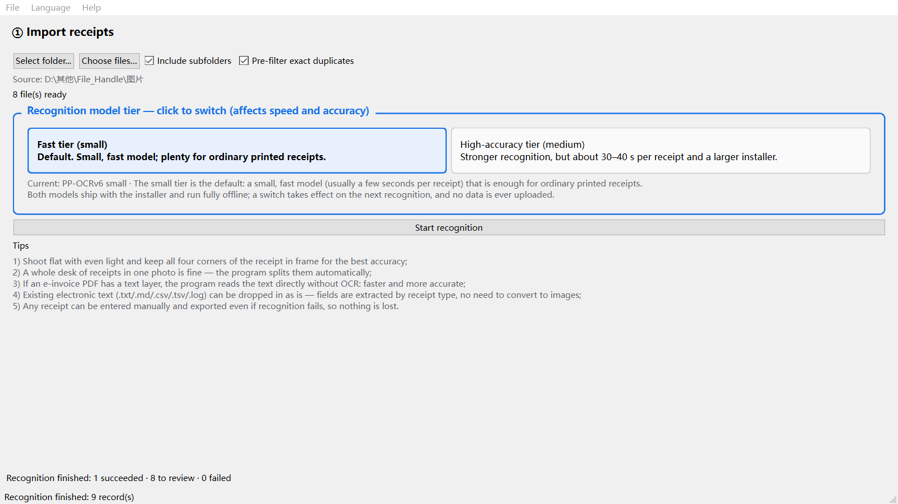
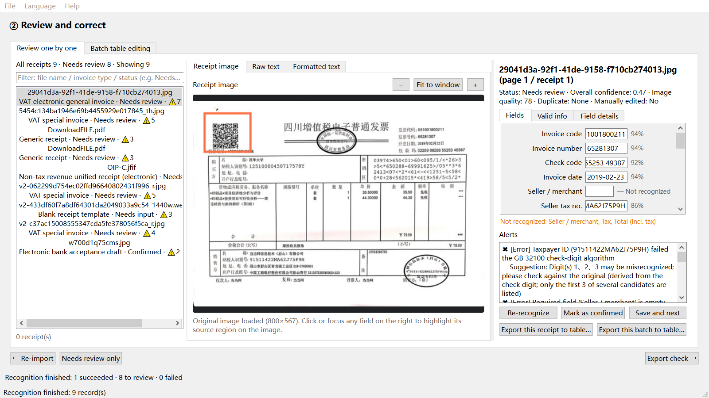
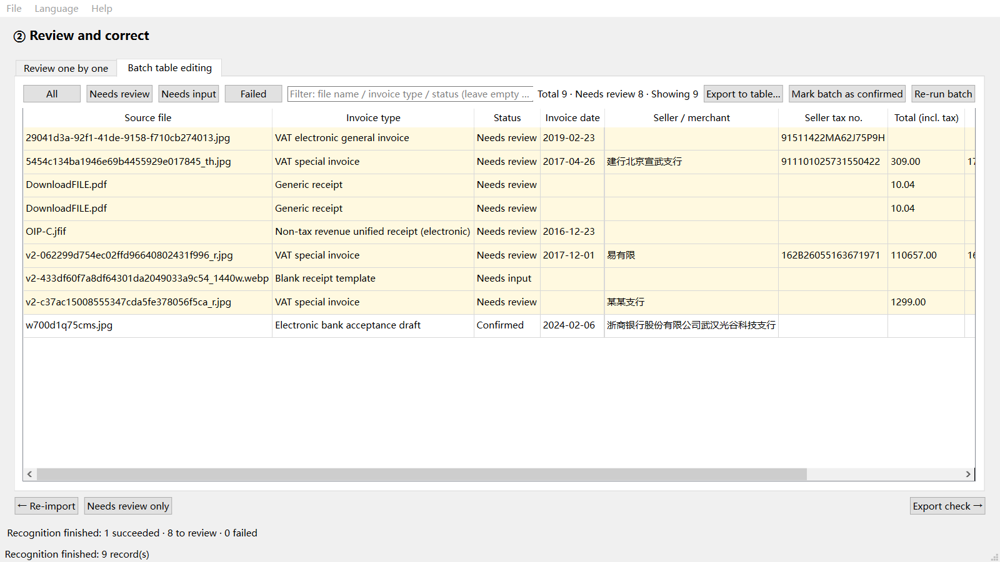
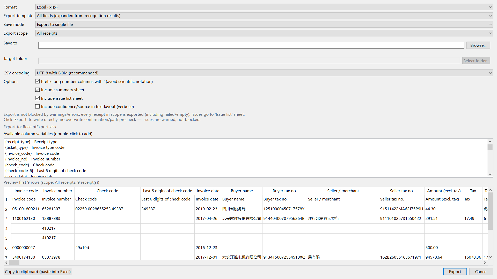

  
   
  

# ReceiptForge

**Offline-first batch receipt OCR and Excel exporter for Windows.**

ReceiptForge turns folders of receipt photos, PDFs, and scans into structured spreadsheets — entirely on your device. No cloud upload, no account, no network access required.

## Download

**Microsoft Store:**  
https://apps.microsoft.com/detail/9nfjv0wbjw9z?cid=DevShareMCLPCS&hl=en-US&gl=US

> This GitHub repository is used for public documentation and feedback. The ReceiptForge application is distributed through the Microsoft Store.

---

## 📸 Screenshots

### 1. Offline Setup & Accuracy Tiers

Choose between standard recognition and a high-accuracy tier. The high-accuracy model (~73 MB) loads locally into memory — perfectly offline, with zero data uploaded. Pre-filter exact duplicates using SHA-256 before processing.

### 2. Interactive Review & Correction

Every field carries a confidence score. Click any field on the right panel to instantly highlight its source region on the original receipt image. ReceiptForge catches errors, like invalid check-digit algorithms (e.g., GB 32100), and warns you without blocking the export.

### 3. Batch Table Editing

Review and correct dozens of receipts at once. Sort by status (`Needs review`, `Needs input`, `Confirmed`), filter by invoice type, and edit values directly in the spreadsheet view for maximum efficiency.

### 4. Structured Export & Data Preview

Export to Excel, CSV (UTF-8 with BOM for perfect character display), or JSON. Preview the extracted columns (Invoice code, Buyer tax no., Seller / merchant, Amount, etc.) before exporting. Optionally prefix long numbers with `'` to prevent Excel from converting them into scientific notation.

---

## Why ReceiptForge

| Feature | What it means |
|---|---|
| **100% local processing** | Receipts never leave your machine. Network access is blocked at the application level. |
| **Batch automation** | Point ReceiptForge at a folder and process every receipt in one run. |
| **Broad input support** | Accepts 18 source formats: 11 image types, PDF, and 6 text formats. |
| **Multi-receipt images** | Automatically splits images that contain more than one receipt. |
| **Duplicate detection** | SHA-256 deduplication helps avoid double-processing the same receipt. |
| **17 receipt layouts** | Covers common Chinese invoices and receipts, including VAT invoices, taxi receipts, train tickets, flight itineraries, and shopping receipts. |
| **Auditable results** | Every field carries a confidence score with color, icon, and text indicators. |
| **No silent hallucination** | Unrecognized values are left blank and flagged — never silently replaced with `0.00`. |
| **Export without data loss** | Warnings and failures do not block export. Every receipt is written to the output, with issues collected in a separate list. |

## How it works

1. **Import** — Select a folder of receipt images, PDFs, or text files.
2. **Review** — Inspect confidence scores, fix validation errors, and correct fields in place.
3. **Export** — Generate Excel, CSV, or JSON for downstream use.

## What ReceiptForge does not do

ReceiptForge is intentionally focused. It does **not**:

- Verify invoice authenticity.
- Generate accounting entries or vouchers.
- Replace professional financial review.

These boundaries are deliberate: ReceiptForge is designed to make receipt data extraction faster and more auditable, not to pretend to be an accounting system.

## Feedback

Found a bug or need support for another receipt layout?

- Open an issue in this repository.
- Include the receipt type, expected fields, and a description of the current behavior.
- Do **not** upload real receipts containing sensitive personal or financial information.

For downloads and updates, use the Microsoft Store link above.

## Keywords

`receipt-ocr` · `invoice-recognition` · `offline-first` · `windows-app` · `excel-export` · `privacy-tools` · `batch-processing` · `finance-automation`
